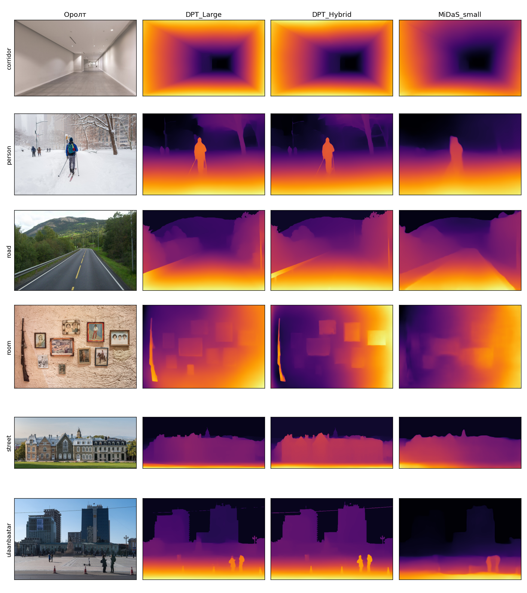

# Monocular Depth Estimation with MiDaS

CS322 Компьютерийн хараа — бие даалтын ажил, **11-р баг**, сэдэв №10.

Нэг энгийн (монокуляр) зурагнаас гүний зураг (depth map) гаргах MiDaS загварыг судалж, ажиллуулж, үр дүнг харьцуулан шинжилнэ.

- **Өгүүлэл:** [Towards Robust Monocular Depth Estimation: Mixing Datasets for Zero-shot Cross-dataset Transfer](https://arxiv.org/abs/1907.01341)
- **Код:** [isl-org/MiDaS](https://github.com/isl-org/MiDaS)

## Багийн гишүүд

| Код | Нэр | Үүрэг |
|---|---|---|
| B242270047 | Б.Төгөлдөр | Загвар, inference pipeline, репо удирдах |
| B242270031 | С.Итгэл | Онол, өгөгдөл, үнэлгээ |
| B242270065 | А.Базарсад | Дүрслэл, хэрэглээ, тайлан |

## Ажлын хуваарь

### Б.Төгөлдөр (B242270047) — Загвар ба inference

- [x] Colab/локал орчин бэлдэх (`torch`, `timm`, `opencv-python`), `requirements.txt` бичих
- [x] `torch.hub`-аар MiDaS загваруудыг ачаалах: `DPT_Large`, `DPT_Hybrid`, `MiDaS_small`
- [x] Зураг оруулаад depth map гаргадаг нийтлэг функц бичих (`src/depth.py`: transform → inference → эх хэмжээ рүү interpolate)
- [x] Гурван загварын хурдыг (нэг зурагт зарцуулах хугацаа, GPU/CPU) хэмжих — `results/speed_benchmark.csv`
- [x] Үндсэн notebook (`notebooks/main.ipynb`) — бусдын хэсгийг дараа нь нэмж нэгтгэнэ
- [ ] Репо, branch, merge-ийг хариуцах

### С.Итгэл (B242270031) — Онол ба үнэлгээ

- [ ] Өгүүллийг уншиж гол санааг товчлох: олон датасет хольж сургах, scale-and-shift invariant loss, zero-shot transfer
- [ ] Монокуляр гүн тооцооллын асуудал, relative depth ба absolute depth-ийн ялгааг тайлбарлах
- [ ] Туршилтын зургууд цуглуулах (`data/images/`): гадаа, дотор, хүн, өөрсдийн авсан зураг — эх сурвалжийг `data/sources.txt`-д бичих
- [ ] Ground truth-тэй жижиг дээж (жишээ нь NYU Depth V2-оос хэдэн зураг) дээр scale/shift тааруулаад AbsRel, δ<1.25 үзүүлэлт тооцох
- [ ] Загвар алдаа гаргасан тохиолдлуудыг (толь, шил, тэнгэр, нарийн биет) олж тайлбарлах

### А.Базарсад (B242270065) — Дүрслэл ба хэрэглээ

- [ ] Depth map-ийг өнгөт colormap-аар (inferno, magma) эх зурагтай зэрэгцүүлж харуулах
- [ ] Гурван загварын үр дүнг нэг хүснэгт/зурагт харьцуулах (`results/`)
- [ ] Хэрэглээ: depth map-аас 3D point cloud үүсгэх (Open3D эсвэл matplotlib 3D)
- [ ] Хэрэглээ: гүнд суурилсан арын фон бүдгэрүүлэх (portrait/bokeh эффект)
- [ ] Тайланг (`report/`) нэгтгэж бичих — бүх гишүүдийн хэсгийг оруулах

### Хамтдаа

- [ ] Эцсийн үр дүнг хамтдаа шалгаж, дүгнэлт гаргах
- [ ] Илтгэлийн слайд бэлдэх (гишүүн бүр өөрийн хэсгийг)

## Ажиллуулах

**Colab:** `notebooks/main.ipynb`-г Colab-д нээгээд (File → Open notebook → GitHub → `Tugu8/Computeriin-haraa`) дарааллаар нь ажиллуулна. Runtime → GPU сонгосон бол илүү хурдан ажиллана.

**Локал:**
```bash
pip install -r requirements.txt
python -m src.run_inference            # data/images доторх бүх зураг × 3 загвар → results/
```

Бусад гишүүд кодоо ингэж ашиглана:
```python
from src.depth import load_model, predict_depth, read_image, depth_to_color
model, transform, device = load_model("DPT_Hybrid")   # эсвэл DPT_Large, MiDaS_small
depth = predict_depth(model, transform, read_image("data/images/road.jpg"), device)
# depth: эх зурагтай ижил H x W хэмжээтэй float32, утга том = ойрхон (relative inverse depth)
```

## Одоогийн үр дүн (CPU, Intel)

| Загвар | Параметр | Хугацаа / зураг |
|---|---|---|
| DPT_Large | 344 сая | ~10–13 с |
| DPT_Hybrid | 123 сая | ~4.5–5 с |
| MiDaS_small | 21 сая | ~0.23 с |



`data/images/` доторх 6 зураг нь pipeline-ыг шалгах зорилготой түр зургууд (Wikimedia Commons, эх сурвалж `data/images/sources.txt`). Итгэл эцсийн туршилтын зургуудыг нэмнэ.

## Фолдерын бүтэц

```
notebooks/   Colab / Jupyter notebook-ууд
src/         Python код (depth.py, visualize.py, evaluate.py ...)
data/images/ Туршилтын зургууд
results/     Гаралтын depth map, график, харьцуулалт
report/      Тайлан, слайд
```

## Ажиллах дүрэм

1. Гишүүн бүр өөрийн нэрээр branch үүсгэнэ: `git checkout -b <нэр>` (жишээ нь `itgel`, `bazarsad`).
2. Ажлаа commit хийгээд push хийж, `main` руу Pull Request нээнэ.
3. Том файл (загварын жин `.pt`, `.pth`) репо руу оруулахгүй — `torch.hub` автоматаар татна.
4. Дууссан ажлынхаа дугуйг `[x]` болгож README-г шинэчилнэ.
